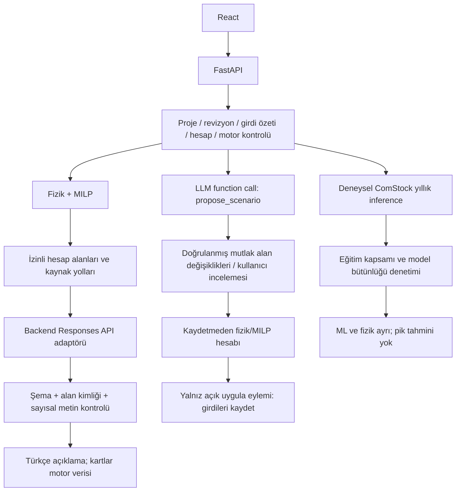

# Hesap bağlamına bağlı AI mimarisi

21 Ekim 2026. Kaynaklar: `backend/calculation_context.py`, `ai_models.py`, `ai_service.py`, `ml_service.py`, `synthetic_ml.py`, `auth.py`, `main.py`; arayüz `AIAssistant.tsx`, `AlternativeScenario.tsx`, `ModelData.tsx`, `SyntheticPrediction.tsx`. Cookie oturumu ve kullanıcı sahipliği eklendi. İnternet yayını henüz doğrulanmadı.

Güncelleme: AI önbellek anahtarı kullanıcı + tam hesap bağlamı + model + prompt sürümü + soru + kapsamı içerir. Model yanıtı önce güçlü şemadan, sonra fact_id izin listesinden ve sayısal iddia filtresinden geçer. Frontend ayrıntı fact referansını da denetler. Soru değişikliği ve kaynak hesap değişikliği ayrı işaretlenir. Karşı-olgusal hesap LLM olmadan çalışır; ana plan eksikse sahte sıfır farkı üretilmez. Geçici senaryo çalışması ana kayda dokunmaz; açık uygulama eylemi formu, revizyonu ve eski sonuç işaretini birlikte yeniler.

HTTP 429 kota/kredi ve hız sınırı kodları ayrılır; kota tekrar edilmez. Yapılandırılmış anahtar, erişilebilir servis ve başarılı son çağrı ayrı durumdur. Son çağrı metaverisi process belleğinde, kullanıcıya özeldir; restart sonrası doğrulanmamış duruma döner. Gerçek kısa kontrol kota/kredi hatası verdi, başarılı AI cevabı alınmadı. Fizik ve sentetik ML harici API çağırmaz.

İkinci deneysel sağlayıcı, bağımsız sentetik binalarla eğitilmiş yıllık elektrik/gaz surrogate modelidir. Bina/aday/hesap/model bağlamıyla gerçek inference yapar; kendi simülatörünü yaklaşık öğrenir, saha veya saatlik pik doğruluğu kanıtı değildir. [Sentetik model kartı](model-card-synthetic.md).

## Birbirinden ayrı üç sağlayıcı

Fizik motoru + SciPy/HiGHS yatırım planını, saatlik yükleri ve kapasite denetimlerini üretir. OpenAI LLM bunların açıklamasını veya izinli bir senaryo taslağını üretir; optimizasyonu değiştirmez. ComStock ile eğitilmiş deneysel gradient boosting modeli yalnız yıllık elektrik/toplam gaz tahminidir; MILP'ye veya elektrik kapasitesi hesabına bağlanmaz.

## Ortak bağlam

`Context`: project_id, input_revision, input_hash, calculation_id, engine_version, model_version. Girdi özeti sıralanmış kanonik Campus JSON'unun SHA-256 özetidir; anahtar/ortam içeriği bu modelde yoktur. Motor sürümü `4.0.0`; fizik sonucunda model_version null çünkü ML kullanılmaz. Hesap kimliği UUID'dir; süre karşılaştırması kimlik kontrolü değildir. Sonuç/karşılaştırma/duyarlılık aynı bağlamı taşır. Saatlik grafik beklenen hesap kimliğini sunucuya gönderir ve dönen bağlamı denetler.

AI ve geçici hesap endpoint'leri önce ve uzun işlemden sonra kaynak bağlamı yeniden doğrular. Proje/girdi/motor/hesap değişirse409. İstemci, geç dönen başka proje/bina yanıtını uygulamaz. AI açıklaması model ve prompt sürümünü ayrıca taşır. ML yanıtı hem fizik `base_context` hem kendi model_version'lı `model_context` alanını taşır; ana planın motor kimliği ML kimliğiyle değiştirilmez.

## A — Planı açıkla / B — Bina seçeneklerini açıkla

`POST /api/ai/explain` yalnız backend'den sabit OpenAI Responses adresine gider. Plan için güncel ana hesap zorunludur; bina açıklaması hesap olmasa da güncel girdi bağlamıyla uygun paketleri hesaplayabilir.

Gönderilenler: kayıtlı planın yatırım/enerji/net maliyet/hedef/çözücü alanları, bina/grup aşımı, seçilen müdahaleler, üç yöntemin tasarrufu, duyarlılık net maliyetleri, tarifeler/kaynak; bina için aynı motordan uygun adayların yatırım/enerji/pik etkileri, SCOP ve veri eksikleri. En fazla32 kombinasyon/bina. Saatlik ham diziler, ortam anahtarı, dosya yollarını çalıştırma komutu veya bütün kullanıcı çalışma alanı gönderilmez.

Strict JSON schema üç ana bulgu ve en fazla altı ayrıntı ister. Her düğüm motorun oluşturduğu bir `fact_id` alanını referans verir. Backend kimliğin izinli listede olduğunu denetler; metindeki rakam veya para/yüzde sembolünü reddeder. Sayısal kartlar LLM metninden ayrıştırılmaz: backend `Fact.value/unit/source_path` alanlarından render edilir. Şema uyumu semantik doğruluk kanıtı değildir; nitel yorumlarda model hatası hâlâ mümkündür. Modelin yeni sayısal sonuç/atıf/kesin seçim nedeni üretmemesi talimatı, bu bağımsız denetimlerin yerine geçmez.

Eğitim/saha/konfor ve RAG sınırları backend'in sabit açıklamalarıdır. “Neden seçilmedi?” sorusuna, karşı-olgusal hesap yoksa kesin neden belirlenmediği açıkça yazılır. Bina panelindeki ayrı **Zorunlu olsaydı hesapla** gerçek, kayıt değiştirmeyen `/api/scenarios/counterfactual` hesabıdır: seçili müdahaleyi zorunlu yapıp aynı mod/bütçe/kapasitede yeniden çözer. Bu fark bir nedensellik ispatı diye sunulmaz. Uyumsuz zorunlu kombinasyon422; uygulanmış müdahale tekrar yeni yatırım yapılamaz.

## C — Alternatif senaryo

`POST /api/ai/scenario-draft` bir adet strict `propose_scenario` function call ister, paralel araç kapalıdır. Model yalnız şu alanların mutlak yeni değerlerini önerir: budget_try, savings_target_pct, electricity_price_try_kwh, heating_price_try_kwh. Şema dışında araç veya alan kabul edilmez; bir alan birden fazla kez değiştirilemez. Serbest Python/shell, dosya veya keyfî endpoint aracı yoktur. Yüzde sorusunun mutlak değere doğru çevrildiği tek başına şemayla kanıtlanamaz; kullanıcıya önce/kayıtlı ve yeni değer tablosu sunulur.

Pydantic Scenario sınırları tekrar uygulanır. Modelin taslak açıklaması, hesaplanmamış tasarruf iddiası içermemesi için kullanıcıya aynen aktarılmaz; backend doğrulanmış değişiklik taslağı olduğunu belirten sabit mesaj üretir. Kullanıcı “Kaydetmeden hesapla” deyince `POST /api/scenarios/evaluate` derin kopyada aynı fizik/MILP motorunu çalıştırır. DATA_FILE, son hesap ve geçmiş dosyaları değişmez. Ana ve alternatif sonuç ayrı gösterilir; alternatifin farklı input_hash/calculation_id'si vardır. Yalnız “Bu senaryoyu uygula” → `/api/scenarios/apply` girdiyi yeni revizyonla kaydeder; eski ana plan güncel olmaz. Sonuç dosyası bu eylemle alternatif diye değiştirilmez.

LLM yokken de açıkça “manuel” etiketli bütçe taslağıyla aynı geçici hesap denenebilir. Bu bir sahte AI cevabı değildir. İlk sürümde doğal dil senaryosu grup bağlantı düzeni, geometri veya müdahale politikası değiştirmez.

## Erişim, önbellek ve hata sınırları

- `backend/.env` kaynak klasöre göre, mevcut süreç değişkenlerini ezmeden yüklenir. Gerçek dosya bu görevde incelenmedi veya yazdırılmadı. API anahtarı frontend/API/export modelinde bulunmaz. Model adı OPENAI_MODEL'den alınır; anahtar eksikse503, fizik/MILP çalışır.
- Sabit sağlayıcı adresi; çağrı başına12sn timeout, normal özellik isteklerinde geçici429/5xx/ağ hatasına en fazla bir tekrar; en fazla24sn civarı ağ bekleme. Bağlantı kontrolü ise **tek deneme**, tekrar yok.
- Soru en fazla1000 karakter; istek JSON'u en fazla70KB, sağlayıcı yanıtı150KB. Açıklama max1800, taslak max700 çıktı tokenı. İşlem başına sayısal doğrulama ve Pydantic sınırları var.
- Aynı istek sürüyorsa409; süreç genelinde dakikada en fazla12 yeni AI isteği. Önbellek30dk, en fazla100 kayıt; anahtar bağlam+model+soru+prompt sürümü+kapsam+bina+hesap alanları özeti. Kalıcı sohbet/veritabanı cache'i yok; çok worker için paylaşılan kota/tekilleştirme yok.
- Sağlayıcı ham hata gövdesi, header veya anahtar loglanmaz/yansıtılmaz. Kaynak değişimi409; servis/şema/alan/sayısal iddia hatası503; veri şeması422. Sahte AI açıklaması üretilmez.

## Doğrulama ve gerçek bağlantı durumu

`backend/test_ai.py`: sağlayıcı mock; bağlam/önbellek/tek araç/yanlış sayısal iddia/servis kesintisi/eski hesap/kalıcı dosyaya yazmayan alternatif ve karşı-olgusal/explicit apply/OpenAPI doğrulaması. Otomatik testler ücretli çağrı yapmaz. Tarayıcı testinde LLM düğmeleri tıklanmaz; manuel alternatif, karşı-olgusal ve gerçek yerel ML inference denenir.

`scripts/check_llm_connection.py` yapılandırma mevcut olduğundan **bir** kısa gerçek çağrı yaptı; sağlayıcı **HTTP429** döndürdü. Başarılı bağlantı, gerçek modelden açıklama veya function calling çıktısı doğrulanmış değildir. HTTP429'un kota mı anlık hız sınırı mı olduğu ham hesap bilgisi okunmadan belirlenmedi; ikinci deneme yapılmadı. Kanıt `artifacts/improvements/llm-connection.json`. Bağlantı düzeldikten sonra kullanıcı ilgili düğmeyi deneyebilir; bu görevde ücretli deneme sayısı artırılmadı.

## Resmî kaynaklar

20 Ekim2026'da okunarak uygulandı: [OpenAI function calling](https://developers.openai.com/api/docs/guides/function-calling), [Structured Outputs](https://developers.openai.com/api/docs/guides/structured-outputs). Bu kaynaklar araç çağrısı ve yapılandırılmış metin sözleşmesini ayırır; uygulama ayrıca kendi fiziksel/bağlamsal doğrulamalarını yapar. RAG koleksiyonu/embedding/arama servisi yoktur; kaynaklı belge cevabı iddiası eklenmedi.

## 4.2 kullanıcı bina akışı

Sürüm `grid-tr-2.1`, katalog `grid-catalog-1.0`: dört sayısal senaryo alanına ek olarak bina müdahalesi aday/zorunlu/hariç taslağı desteklenir. Bina/uygunluk, uygulanmış fiziksel durum ve tam kombinasyon sunucuda kontrol edilir. Belirsiz çok bina sorusu veya geçersiz bina kodu hesap öncesinde reddedilir. Model ek bilgi isterse changes boş + clarification döner; frontend çalıştır/uygula eylemi sunmaz. Kullanıcının ilk eksik bina taslağı manuel/CSV ile tamamlanır; AI doğal dil taslağı güncel ana plan üzerinden çalışır. Bedelsiz manuel yol aynı `/api/scenarios/evaluate` motorunu kullanır. ML bu seçimlere bağlanmadı. [Uçtan uca kapsam](own-building-flow.md).
