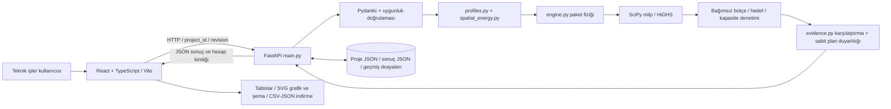

# Portfolio25-GRID — mevcut sistem incelemesi

**Tarihsel inceleme:** Bu bulgular geliştirme öncesi durumu kaydeder; güncel hata listesi değildir. Kaynakta doğrulanıp düzeltilenler, gerçekten çalıştırılan kontroller ve kalan sınırlar [iyileştirme raporunda](improvement-report.md) bulunur. Önceki kanıt dosyaları korunmuştur.

**Tarih: 20 Ekim 2026.** İnceleme kökü: `C:\Yazılım\Applications\Portfolio25-GRID`. Canlı kanıt ilk toplama zamanı `2026-10-20T08:35Z`; aynı oturumda sonraki tarayıcı ve hata kontrolleri de yapıldı. `git rev-parse HEAD` bu klasörde Git deposu bulamadı; commit/branch, izlenen dosyalar veya değişiklik geçmişi doğrulanamadı. `rg` ile çalışma alanında AGENTS.md bulunmadı.

Bu rapor önceki tamamlanma mesajlarının tekrarı değildir: kaynak dosyaları, belgeler, çalışan OpenAPI, mevcut beş proje, testler ve Chrome görüntüleri karşılaştırıldı. **Yeni ürün özelliği veya hata düzeltmesi yapılmadı.** Yalnız raporlar ve inceleme kanıtları üretildi; üretim derlemesi mevcut `frontend/dist` çıktısını yeniden oluşturdu. Ortam dosyalarının içeriği okunmadı, anahtar/LLM isteği kullanılmadı. Kullanıcı girdilerine yazan denemeler özgün projelerde yapılmadı.

Kanıt paketi: [artifacts/system-audit](../artifacts/system-audit/). Başlıca dosyalar: [canlı API özeti](../artifacts/system-audit/live-evidence.json), [OpenAPI](../artifacts/system-audit/openapi.json), [geçici veri hata deneyleri](../artifacts/system-audit/temporary-probes.json), [görüntü manifesti](../artifacts/system-audit/screenshots.json), [tarayıcı kontrolleri](../artifacts/system-audit/browser-checks.json), [veri bütünlüğü](../artifacts/system-audit/data-integrity.json). Manifest her görüntünün proje kimliği, revizyonu, hesap kimliği/modu, durumu ve viewport'unu belirtir; farklı görüntüler tek senaryo gibi birleştirilmemelidir.

## 1. Amaç ve güncel ürün durumu

Uygulama bir bina veya bina grubunun sınırlı yatırım bütçesini, modellenmiş enerji tasarrufu ve elektrik bağlantı kapasitesiyle birlikte değerlendiren karar destek prototipidir. Teknik işler/enerji yöneticisi farklı varsayımlarla hangi dönüşüm paketlerinin seçilebildiğini, maliyetini ve enerji etkisini görebilir. Sonuç, sahada tasarruf garantisi veya trafo yatırımının kesin önlendiği belgesi değildir.

Kullanıcı bina alanı/kullanımı, yıllık elektrik, ısıtma gazı ve diğer gaz, bina limitleri, kazan/yalıtım/ısı pompası/maliyet varsayımları girer. Proje bütçesi, tasarruf hedefi, fiziksel bağlantı grupları, tarifeler/emisyon kaynakları, süre ve A/B modunu ayarlar. Pilot binalarda seçili kat varsayımları ile çatı/aydınlatma/program senaryolarını da düzenleyebilir. Çıktı; seçilmiş paketler, önce/sonra enerji/yoğunluk/maliyet/emisyon, net tasarruf/geri ödeme, saatlik grup yükü, kapasite denetimleri, hedef/çözücü durumu, üç yöntemli karşılaştırma ve sabit plan duyarlılığıdır.

Teknik dayanak: [models.py](../backend/models.py), [engine.py](../backend/engine.py), [App.tsx](../frontend/src/App.tsx). Ana veri şeması **3.0**, isteğe bağlı kat modeli **1.0**; UI paket sürümü **0.3.0**, API bilgi sürümü **0.2.0**. Bu sürümler aynı şeyi temsil etmiyor.

| Yetenek / proje türü | Kaynaktan ve çalıştırmadan görülen durum | Sınır |
| --- | --- | --- |
| Tek bina | Çalışıyor; mevcut binanın bağımsız proje kopyası, bütçe/kapasite, A/B hesap, kayıt/export | Sıfırdan serbest bina çizimi/ölçüm yükleme değil |
| Kampüs / çok bina | Çalışıyor; 1–50 bina şeması; ortak veya ayrı gruplar | Canlı veride en çok 8 bina sınandı; 50 bina performans garantisi yok |
| Konut sitesi | **Sınırlı sentetik örnek**: A/B blok, ortak bütçe, ayrı elektrik, bağımsız kazanlar | Genel konut fiziği/ortak kazan/daire sayaçları/konfor doğrulanmış değil |
| Ofis ve küçük otel | Pilot tek bina örnekleri gerçekten mevcut; mevcut gaz dönüşüm motoruyla hesaplanıyor | Otel sıcak suyu ayrılıp korunuyor; sıcak su dönüşümü yok |
| Kat ve kullanım dağılımı | Sekiz pilot binada çalışıyor; eğitim/A blok/ofis ayrıntılı, diğerleri kaba | Ölçüm veya dinamik termal simülasyon değil; eski kampüste kat verisi yok |
| Çatı, kabuk, aydınlatma, HP | Uygunluk kurallarıyla gerçek hesap | Sonuçlar varsayımların doğruluğuna bağlı |
| HVAC çalışma programı | Uygun alanlarda hesaplanabilir, açık uzman inceleme kabulü gerekir | Lab/konut/otel azaltımı engelli; sıcaklık/konfor kanıtı yok |
| Proje kayıtları, son hesap, export | Çalışıyor; JSON dosyaları, revizyon ve hesap kimliği korumaları | Tam girdi sürüm geçmişi veya geçmiş gezme ekranı yok |
| Karşılaştırma / duyarlılık | Çalışıyor; aynı uygun evrende 3 yöntem, 9 sabit-plan satırı | Sezgisel optimum değil; duyarlılık olasılık/güven aralığı değil |
| ML tahmin sağlayıcısı ve dinamik zon/konfor motoru | Yalnız yol haritasında | Eğitim, model artefaktı, inference, RC/EnergyPlus akışı yok |
| LLM açıklayıcı / RAG | Yok; yalnız kullanılmayan ortam hazırlığı | Model entegrasyonu veya doğrulanmış API çağrısı yok |
| Kullanıcı hesabı, ödeme, EV, batarya, IoT, otonom kontrol, chatbot | Yok | Arayüzde çalışan özellik gibi sunulmuyor |

Canlı listede **5 proje / 16 bina** var: önceden var olan 8 binalı Örnek Kampüs r27 ve ayrıca dört pilotta 8 bina (her biri r1). Bu sayılar bütün kayıtlardaki binadır; yeni pilotun sekiz binasıyla karıştırılmamalıdır. Pilot bütçeleri 12 milyon / 7 milyon / 2,8 milyon / 4 milyon TL; yalnız pilot kampüste 1100 kW ortak bağlantı var. Konutun 420/462 kW grupları, ofisin 294 kW ve otelin 392 kW bağlantıları bağımsız. Kaynak: [pilot_kayseri.py](../backend/pilot_kayseri.py), canlı kanıt.

**Veri kökeni:** mevcut bütün proje girdileri sentetik. Kat çıktıları `modelled_allocation`, bazı ortak ekipman satırları `assumption`; bunlar sentetik girdinin hesaplanmış dağılımlarıdır. `Provenance` measured/external_simulation/synthetic sözlüğünü tanımlasa da `CampusUpdate` mevcut akışta bina kind=synthetic ve seed=25 zorunlu tutar. Gerçek ölçüm/harici simülasyon içe alma üründe desteklenmiyor. Kullanıcı bir değeri düzenleyince ölçülmüş veri etiketi kazanmaz. Kayseri hava eğrisi proje içinde sentetiktir; dış hava dosyası/yılı/lisansı doğrulaması yoktur.

**Çalışma durumu:** mevcut frontend `http://127.0.0.1:5173`, backend `http://127.0.0.1:8000`; sağlık 200 ve frontend erişimi doğrulandı. Sunucu PID'leri incelemede 7476 ve 25240; ikinci uygulama sunucusu başlatılmadı, mevcutlar kapatılmadı. Bunlar yerel geliştirme sunucularıdır. İnternet yayını, alan adı, TLS, ters proxy veya erişilebilir genel URL kanıtı yoktur; yapılmış gibi sunulmamalıdır. Başlatma/durdurma komutları [README](../README.md) ve `scripts/stop-local.ps1` içinde.

## 2. Mimari ve “Hesapla” veri akışı

Tarayıcı React arayüzü, FastAPI'ye HTTP ile bağlanır. Kalıcı veri ilişkisel veritabanında değil, backend JSON dosyalarındadır. Backend saatlik seçenek profillerini formüllerle üretir, HiGHS MILP ile bir paket kombinasyonu seçer ve tekrar fiziksel/bütçesel kontrolden geçirir. ML veya harici LLM bu zincirde yer almaz.

Gerçek çağrı sırası:

1. [App.tsx](../frontend/src/App.tsx) `compute()`; senaryo sayfasındaki `.compute-button` veya ana eylem çalıştırır. Diğer sayfalarda ana eylem önce senaryo görünümüne götürür. Kirli bina/kat/proje taslağı veya CSV önizlemesi kontrol edilir; HTML form doğrulaması ve süre sınırı uygulanır.
2. Senaryo taslağı değişmişse önce [api.ts](../frontend/src/api.ts) `saveCampus` ile **PUT `/api/campus?project_id=...`** yapılır. Backend bu taslağı doğrular ve revizyonu artırır. Kaydedilmemiş tarayıcı nesnesi doğrudan optimizasyona gönderilmez.
3. `calculateCampus` → **POST `/api/calculate?project_id=...`**, gövde `{revision, mode, time_limit_s}`. Küçük gövde kayıtlı girdileri işaret eder.
4. [main.py](../backend/main.py) `calculate_plan`: Pydantic istek şeması, global `compute_lock`, kayıt kilidi ve revizyon eşleşmesi. Proje bağlamı `ContextVar` ile seçilir.
5. [engine.py](../backend/engine.py) `prepare` her bina için profil üretip yıllık audit yapar; uygun paketleri hesaplar. `solve_packages` maliyet/enerji/saatlik elektrik tablolarıyla MILP kurar. Seçimden sonra orijinal birimlerle bütçe, her bina, her grup ve B hedefi doğrulanır.
6. [evidence.py](../backend/evidence.py) aynı seçeneklerle oran sezgiselini, elektrik kısıtsız ikinci MILP'yi ve seçilmiş GRID planının 9 duyarlılık satırını üretir. Dolayısıyla kullanıcı süre sınırı toplam HTTP süresinin tavanı değildir; iki MILP'ye ayrı ayrı uygulanır.
7. `calculate_plan` son kez güncel revizyonu denetler. Eski sonuç varsa SHA-256 dosya adıyla history'ye arşivler; yeni `<stem>.result.json` `.tmp`/replace ile yazılır. HTTP cevabı `CalculationResult` olur.
8. Frontend sonucu aldıktan sonra **GET `/api/campus/snapshot`** ile doğrular; revizyon/mod/çözüm toplam süresi eşleşirse sonuç ekranını açar. Snapshot'taki `calculation_id`, serileştirilmiş sonucun SHA-256 özetidir. Süre alanları dahil olduğundan aynı girdiyi yeniden hesaplamak yeni kimlik üretebilir; bu alan rastgele UUID veya mühendislik sertifikası değildir.
9. Sonuç export'unda revizyon ve beklenen hesap kimliği birlikte gönderilir; aynı revizyonda başka hesap gelmişse 409 döner. İstemci ayrıca kirli taslak/mod değişikliğiyle sonucu güncel değil sayar. Saatlik grafik endpoint'i revizyon/mod taşır ama **hesap kimliği taşımaz**; bunun doğurduğu sınırlama bölüm 10'dadır.

Sürümler doğrudan kurulu paket metadata'sından okundu: Python 3.13.7; FastAPI 0.141.1, Pydantic 2.11.9, SciPy 1.17.1, NumPy 2.4.2, Uvicorn 0.52.4, python-dotenv 1.2.2. Frontend `package.json` ve lock dosyasında React 19.3.1, Vite 8.3.4, TypeScript 7.0.2; mevcut kurulumla test/derleme geçti. Sürüm tahmini yapılmadı.

## 3. Gerçek ekran, sekme ve modal envanteri

Tarayıcıda **tek ürün route'u `/`** var. React Router, `/results` veya `/buildings/B01` gibi ürün URL'leri yok. `App` içindeki `page: overview/building/scenario/results` state'i görünümü değiştirir. Yenileme genel bakışa döner; yalnız seçili proje kimliği `localStorage['portfolio25-project']` ile saklanır. Aşağıdaki yollar menü/sekme erişimidir, hayalî route değildir.

### 3.1 Ortak çerçeve, proje ve pilot seçimi

Teknik işler kullanıcısı hangi veri setinde çalıştığını buradan seçer. Sol menü masaüstünde, üst menü mobilde dört gerçek görünüm sunar. Üstte API bağlantı durumu, yenile, ana hesap eylemi, varsayımlar, export kapsamı ve CSV/JSON vardır; sentetik etiket kalıcı olarak görünür.

Teknik ayrıntı: [App.tsx](../frontend/src/App.tsx), [Projects.tsx](../frontend/src/Projects.tsx), [PilotLoader.tsx](../frontend/src/PilotLoader.tsx), [api.ts](../frontend/src/api.ts). GET projects/snapshot/last ve pilot status kullanılır. Proje seçimi bir kayıt yazmaz; yeni proje formu kaynak bina kimliklerini seçip POST projects ile **ayrı kopya** oluşturur. Sıfırdan bina ekleme formu değildir. Pilotun POST load eylemi mevcut kampüsü değiştirmez; yüklenmiş örnekleri korur. Pilot kartları bağımsız projelerin bütçe/bina/grup bilgisini gösterir; toplam bütçe veya tek trafo yaratmaz.

Yüklemede spinner, API hatasında açık hata/tekrar dene, bekleyen değişiklikte proje seçiminde engel vardır. Varsayımlar modalı veri yokken bağlantı gereğini söyler. Export pending durumda kapanır; inputs kapsamı güncel kayıtlı girdiyi, result kapsamı güncel hesabı indirir. UI bağlantı noktası aktif ping değil son işlemin durumudur. Persona/başlık metinleri sabit demo etiketleridir; hesap veya rol değildir. AI yoktur.

### 3.2 Menü → “Kampüs özeti” (`page=overview`)

Projenin yıllık tüketimini, maliyetini ve bina envanterini inceleme ekranıdır. Kartlar nihai enerji, alanla ağırlıklı yoğunluk, enerji maliyeti ve eşzamanlı pik gösterir. Çok grupta toplam pik yalnız tanısal olarak etiketlenir. Veri hazırlığı kartında saat sayısı ve tutarlılık bulunur; bina tablosunda alan, elektrik, toplam gaz, profil piki/bina sınırı ve düzenleme düğmesi vardır.

Kartlar snapshot'ın **hesaplanmış baseline** alanlarından gelir; yıllık bina girdileri kayıt değerleridir. Arama yalnız istemci filtrelemesidir; eşleşmezse boş arama mesajı çıkar. CSV düğmesi dosya seçer, 2 MB/uzantı/şablon/satır/provenans kontrolü sonrası önizleme sunar; “uygula” PUT yapar. Hatalı dosya kaydedilmez; eski sonuç sütunları içe alınmaz. CSV keyfî gerçek sayaç veya hava dosyası yükleyicisi değildir. Kaynak: `App.tsx`, [csv.ts](../frontend/src/csv.ts). AI yoktur.

### 3.3 Genel bakış → “Kampüs/Proje senaryo modeli” paneli

Koordinat içermeyen SVG bina şemasıdır. Önce/sonra düğmeleri, paket renk anahtarı ve seçilen binanın yatırım/tasarruf/pik farkı bulunur. Sonra görünümü yalnız güncel uygun plan varsa açılır; yoksa müdahalesiz görünüm ve açıklama vardır. Binaya tıklama bilgi panelini; “Paketleri karşılaştır” bina detayını açar.

Teknik ayrıntı: [ScenarioModel.tsx](../frontend/src/ScenarioModel.tsx), [visuals.tsx](../frontend/src/visuals.tsx) `CampusMap`. Konumlar sabit/ızgara tabanlı **çizim yerleşimi**, değerler snapshot/plan/profile audit verisidir; harita API'si, GIS veya sensör bağlantısı yoktur. Renk yalnız dört ısıtma paketini kodlar; kat müdahaleleri için ayrı renk yoktur. Hesaplanan katkı açıklamaları metin şablonudur; LLM değildir.

### 3.4 Menü → “Bina detayları” (`page=building`)

Soldaki bina listesinden bir bina seçilir. Alan/kullanım, yıllık elektrik/ısıtma/diğer gaz ve bina sınırı kartları, kat analizi, uygun paket tablosu, filtrelenen paketlerin gerekçesi, seçilmiş paketin sayısal katkısı ve bina varsayımları bulunur. Tablo yatırım, nihai enerji tasarrufu, net ekonomik fark, pik/sınır, geri ödeme gösterir. Net negatif değerler saklanmaz.

Teknik ayrıntı: [BuildingDetail.tsx](../frontend/src/BuildingDetail.tsx); GET buildings/{id}/packages. Dönen revizyon/bina kimliği ve paketlerin boş olmaması denetlenir. Loading, API hata/yeniden dene ve eski kayıtta kat verisi yok durumları gerçek kodda vardır. Paket endpoint'i her alternatifte kayıtlı kat seçimlerini sabit taban olarak içerir. Seçim açıklaması en yüksek tek-bina alternatifiyle sayısal farkları gösterir; “neden optimumda bu bina seçildi” için karşı-olgusal çözüm yapmaz. AI yoktur.

### 3.5 Bina detayları → “Katlar”, “Enerji Dağılımı”, “Müdahale Senaryoları”

Bu üç düğme aynı bina içindeki `SpatialDetail` sekmeleridir. Ölçülmüş veri, gerçek mimari plan veya konfor simülasyonu olarak sunulmaz. Kaynak/eksik bilgi etiketleri gösterilir.

- **Katlar:** elektrik/yakıt filtresi; kat başına kWh/yıl, pay, kWh/m²-yıl; ayrıca katlara dağıtılmamış ortak ekipman satırı. Açılır kat kartları zon alan/yükseklik/kullanım/HVAC saatleri/doluluk/cephe/pencere/çatı/zemin/sistem kimliği/kurulu yük ve eksikleri gösterir. Merkezî sistemlerin hangi zonlara hizmet verdiği açılır panelde vardır. SHARED satırına sıfır alan üzerinden yoğunluk uydurulmaz.
- **Enerji Dağılımı:** aynı toplamın kullanım amacı kırılımı ve desteklenen son kullanım bileşenleri. Kat toplamıyla toplanmaması açıkça yazılıdır. Sıcak su gazının diğer gazın alt kümesi olduğu, artık elektrik ve uzlaştırma farkları gösterilir. Faydalı ısı nihai enerjiye eklenmez.
- **Müdahale Senaryoları:** beş öneri kartı; veri bulgusu, etki alanı, uygulanabilirlik/eksikler; hesaplanmış ise elektrik/yakıt, yatırım/net fark/pik değişimi. Uygunsuz öneri “yalnız inceleme adayı”dır ve deneme düğmesi yoktur. Alan kapsamı (UI'da tümü veya tek zon), çatı/aydınlatma/program seçimleri, program uzman kabulü ve ısıtma paketi önizlemesi vardır. Çatı hedef U/maliyeti, aydınlatma ve kontrol maliyetleri, zon aydınlatma hedefi/kurulu gücü/hazırlık payı düzenlenebilir; bütün geometri ve kullanım alanlarını kuran tam bir editör yoktur.

Teknik ayrıntı: [SpatialDetail.tsx](../frontend/src/SpatialDetail.tsx), [spatialTypes.ts](../frontend/src/spatialTypes.ts); GET spatial ve POST spatial/evaluate. Veri yükleme/hata/yeniden yükle/veri yok durumları var. Önizleme kaydetmez; aynı planı fizik motorundan geçirir ve diğer binalar mevcut durumdayken kapasiteyi denetler. Seçim/varsayım/önizleme paket imzası veya revizyon değişirse önizleme güncel değil olur. “Kat seçimlerini ve varsayımları kaydet” mevcut PUT ile kayıt yapar; sonraki portföy hesabına sabit taban olarak bir kez yansır. **Önizlemede seçilen ısıtma paketi portföye zorunlu seçim olarak kaydedilmez**, MILP onu ayrıca seçer. AI yoktur.

### 3.6 Bina düzenleme modalı

Tablodaki kalem veya detaydan “Bina bilgilerini düzenle” erişilir. Ad/kullanım/alan/yıl/yıllık tüketimler, bina sınırı, eski referans pik, mevcut ısıtma/dağıtım/yalıtım uygunluğu, kaynak ve dönüşüm varsayımları düzenlenir. Kaydet PUT; vazgeç/kapat taslağı bırakır. Hata modal içinde görünür. Alan değişikliği kat toplamıyla uyuşmazsa backend reddeder; kat geometrisini otomatik ölçeklemez.

Teknik ayrıntı: [forms.tsx](../frontend/src/forms.tsx) `BuildingEditor`, HTML `<dialog>`, `App.commit`, `saveCampus`. Kaynak korunur. Referans pik düzenlense de hesapta kullanılmaz. Eksik sistem fiziği sihirli biçimde tamamlanmaz; uygun olmayan dönüşümler filtrelenir. AI yoktur.

### 3.7 Menü → “Senaryo girdileri” (`page=scenario`)

Planlayıcı burada bütçe/hedefi, tek grupta grup kapasitesini, fiyat/emisyon varsayımlarını ve A/B amacını belirler. “Proje, bağlantı grupları ve duyarlılık varsayımları” açılır bölümünde proje adı, grup ad/kapasite/kaynak/üyelikleri, bağımsız bağlantılara ayırma ve düşük/yüksek çarpanlar düzenlenir. Çok grupta tek ortak kapasite alanı gizlenir.

Teknik ayrıntı: [Projects.tsx](../frontend/src/Projects.tsx) `ProjectSettings`, [forms.tsx](../frontend/src/forms.tsx) `ScenarioForm`, `App.compute`. Form taslakları yereldir; kayıt PUT, hesap POST calculate. Sayfa DOM'da `hidden` ile tutulur; görünüm değişimi senaryo taslağını korur. Süre 0,01–60 sn; varsayılan10. Proje taslağıyla senaryo taslağı ayrı kaydetme denetimi taşır. Kaynak/tarih alanları fiyat/emisyon/sensitivity varsayımlarına aittir; resmî değer doğrulaması yapılmaz. Loading/busy düğme durumları, HTML sınırları ve API hataları vardır. AI yoktur.

### 3.8 Menü → “Optimizasyon sonucu” (`page=results`)

Planın yatırım, kalan bütçe, tasarruf kWh/% ve enerji yoğunluğu/maliyet etkisi değerlendirilir. Çözücü durumu, süre/gap, hedef ve kapasite kartları; seçilmiş paketler, önce/sonra enerji/işletme/emisyon tablosu, geri ödeme, karşılaştırma ve duyarlılık panelleri bulunur. Paketleri gör bina detayına; CSV indir korumalı sonuca; varsayımlar modalına bağlanır.

Teknik ayrıntı: [Results.tsx](../frontend/src/Results.tsx), [format.ts](../frontend/src/format.ts). Değerler gerçek `CalculationResult` nesnesinden gelir. Ayrı durumlar: hiç hesap yok → boş sonuç; eski revizyon/kirli taslak/mod farkı → sadece tarihsel özet ve yeniden hesaplama; infeasible/failed → plan yok; limit_no_solution → imkânsızlık kanıtı olmayan aday yok; feasible_limit → uygun, optimum kanıtı yok; optimal ve proven → optimum etiketi. Önceki sonuç güncel bütçe veya yeni grafikle birlikte sunulmaz. Bu incelemede actual optimum ve infeasible tarayıcıda, süre sınırı durumları mock çözücü testlerinde doğrulandı; gerçek duvar saati limitine yakalanan örnek çalıştırılmadı. AI yoktur.

### 3.9 Sonuç → saatlik grafik, karşılaştırma ve duyarlılık panelleri

**Grafik:** [LoadChart.tsx](../frontend/src/LoadChart.tsx), [profileData.ts](../frontend/src/profileData.ts). GET campus/profiles; grup seçimi, başlangıç tarihi, 1/7/30 gün veya yıl, pik haftası, işaretçi ve saat sürgüsü var. SVG önce/sonra/grup kapasitesini aynı eksende çizer. Tam yıl, zaman sürekliliği, revizyon/mod/proje, negatif/sonlu değerler ve yıllık integraller tarayıcıda doğrulanır; eksik profil sıfırla tamamlanmaz, hata/yeniden yükle gösterilir. Ölçülmüş kapasite iddiası yoktur.

**Karşılaştırma:** [DecisionEvidence.tsx](../frontend/src/DecisionEvidence.tsx). Ratio, without_grid, grid için gerçek yatırım/kalan bütçe/tasarruf/hedef/kapasite ihlalleri. Açılır açıklamada oran tanımı ve seçilen paketler vardır. Ayrı LLM açıklama paneli değildir. Kısıtsız yöntem de sınırı karşılıyorsa GRID üstünlüğü gösterilmediği açıkça yazılır; QA ofis örneğinde bu durum görüldü.

**Duyarlılık:** Aynı bileşende SCOP/maliyet/yalıtımın düşük/temel/yüksek dokuz satırı. Paket ve boyutlar sabittir; tek parametre değişir, yeniden optimize edilmez. Fiziksel aralık dışı satırda değer kırpılmaz, hesaplanmadı gösterilir. Uygun GRID planı yoksa satırlar boş/açıklamalıdır. Bu iki panel ek API istemez; calculate/snapshot sonucu içindedir. Üçünde de AI yoktur.

### 3.10 Varsayımlar ve veri kaynağı modalı

Ortak “Varsayımlar”, “Kaynak ve sınırlar” veya sonuç detaylarından açılır. Proje kaynağı, dönem, tarife/emisyon, bina parametreleri, dönüşüm notları, model sınırları ve Swagger bağlantısını gösterir. API'deki kayıtlar ve sabit açıklama metinlerinin birleşimidir; model tarafından yazılmaz. Kaynak `App.tsx` `Modal`. Kapat/Escape ve API sözleşmesini yeni sekmede açma gerçek işlevlerdir. Sohbet/AI açıklayıcı modalı yoktur.

## 4. Çalışan arayüzün görsel ve davranış incelemesi

Mevcut iki sunucu kullanılarak **headless Chrome/Selenium** ile gerçek sayfa açıldı; görüntüler ayrıca görsel olarak incelendi. Görsel kontrol yapılmış gibi varsayılmadı. İlk otomasyon denemelerinde hatalı test seçicisi ve yükleme bitmeden seçim denemesi vardı; yalnız artefakt test scripti düzeltildi, uygulama değiştirilmedi. Son tam tur geçti. [browser.py](../artifacts/system-audit/browser.py) çalıştırması, ayrı [mobile_panels.py](../artifacts/system-audit/mobile_panels.py) salt okunur ek görüntüleri ve manifest yeniden üretimi açıklar.

Özgün Örnek Kampüs r27 genel bakış/paket/varsayımlar; pilot eğitim binası r1 katlar/kullanım/birleşik çatı+aydınlatma+HP önizlemesi görüntülendi. Sonuç/karşılaştırma/duyarlılık/harita ve hata durumları yalnız yeni QA ofis kopyasında çekildi. O QA proje teslim verisi değildir; bilinen dosya baytları kontrol edilip arşivlenerek canlı listeden kaldırıldı. Görüntü adındaki “mobile-floors” sayfanın üstünü gösterir; kat panelinin kendisi ayrıca “mobile-floor-panel” görüntüsündedir.

| İncelenen unsur | Gözlem ve kapsam |
| --- | --- |
| Masaüstü | Yeşil/beyaz hiyerarşi, ana eylem ve sentetik uyarı görünür. Kartlar ve paket tablosu sunuma uygun; uzun kat senaryoları aşağı kaydırmayı gerektirir. |
| Mobil menü | Yan sütun içerik genişliğini daraltmıyor; dört üst menü öğesi var. Yazıları masaüstüne göre küçük; ekran okuyucu/WCAG denetimi yapılmadı. |
| Form ve açıklamalar | Alan etiketleri/birimler/kaynaklar var. Mobil üstte proje seçimi, pilot kartı, başlık/export/akış adımları yaklaşık ilk ekranı kaplıyor; asıl form/kat tablosu için kaydırmak gerekiyor. |
| Taşma | 4 ana görünüm × 390/500/768/1536 px: belge genişliği viewport'u aşmadı. Bu “bütün içerik kaydırmasız sığıyor” demek değil; geniş tablolar kendi yatay kaydırma alanında. |
| Grafik | Masaüstünde çizgiler ve kapasite ayrılıyor; küçük genişliklerde SVG yazıları küçülür. Gerçek cihaz dokunma/erişilebilirlik testi yok; klavye saat sürgüsü mevcut. |
| Ana işlevler | Proje seçme, A hesabı, önizleme, mod B çözümsüzlük, taslakta stale/export engeli ve CSV hatası denendi. Bu turda tüm düğmelerin tek tek tıklama denetimi yapılmadı; kalan bağlantılar koddan izlendi. |
| API hatası | Yalnız test tarayıcısında API URL'si engellenerek görünür hata/yeniden dene durumu çekildi; gerçek sunucu kapatılmadı, ağ engeli kaldırılıp tekrar bağlanıldı. |

Toplam **23 güncel görüntü** [manifestte](../artifacts/system-audit/screenshots.json) listelidir: 01 mevcut genel bakış, 02 bina/paket, 03 varsayımlar, 04 katlar, 05 kullanım, 06 birleşik önizleme, 07 senaryo, 08 sonuç, 09 grafik, 10 karşılaştırma, 11 duyarlılık, 12 sonra haritası, 13 eski sonuç, 14 CSV hatası, 15 çözümsüzlük, 16 API hatası; ayrıca mobil sayfa/panel görüntüleri. Bunlar farklı revizyon/durumların ayrı kanıtlarıdır. Test tarayıcısının konsol kaydında uygulama JavaScript hatası görülmedi; Vite bağlantısı ve React DevTools bilgi mesajı vardı.

## 5. Backend ve API'lerin gerçek kapsamı

Bütün iş endpoint'leri [main.py](../backend/main.py) içindedir; ayrı router katmanı yoktur. Ayrıntılı 16 satırlı istek/yanıt/hata/yazma/yetki/servis tablosu [api-inventory.md](api-inventory.md) dosyasındadır. Kod ve çalışan OpenAPI işlem kümesi eşleşti. FastAPI'nin `/docs`, `/redoc`, `/openapi.json`, `/docs/oauth2-redirect` otomatik yolları ayrı açıklanmıştır; OAuth yardımcı sayfası bir login uygulaması değildir.

Önemli teknik ayrıntılar: proje seçimi middleware'dedir ve OpenAPI parametrelerinde görünmez. Birçok dict yanıtının tam response şeması yoktur; güçlü şemalar CampusResponse/CalculationResult ve giriş modellerindedir. Sağlık ready alanı sabit olduğundan tek başına solver veya bütün veri dosyalarının geçerli olduğunu kanıtlamaz. POST spatial/evaluate kayıt değiştirmeyen bir hesaplamadır. GET campus/projects, ilk oluşturma veya eski şema dönüşümünde dosya yazabilen istisnalardır; bu turdaki mevcut kayıtlar şema3 olduğundan okumalarda değişmedi.

Bu uygulama güvenilmeyen internet kullanıcılarına açık, çok kullanıcılı servis olarak doğrulanmadı. Tüm API işlemleri anonimdir; sınırlı CORS izinleri yetki denetimi sağlamaz. Kullanıcıya genel erişim URL'si verilmedi.

## 6. Veri ilişkileri, birimler ve kalıcılık

Bir proje bütçe/senaryo/profil/duyarlılık ve bina listesini taşır. Her bina elektrik için tam bir bağlantı grubuna aittir; kendi bina limiti ayrıca vardır. Bina isteğe bağlı kat/zon ve ortak sistem modelini taşır. Zonlar birden fazla kata hizmet veren merkezî sistemlere referans verir; her kat yeni cihazmış gibi sayılmaz.

| Nesne / alan | Anlam ve birim / sınır |
| --- | --- |
| Campus `id,name,revision,schema_version` | Proje kimliği/adı; pozitif girdi revizyonu; çalışan ana şema3.0. Sınıfın adı Campus kalmış olsa da tek bina mümkündür. |
| `scenario.budget_try,savings_target_pct` | Proje toplam ilk yatırım bütçesi TL; toplam nihai enerjiye göre yüzde hedef. A'da bilgi, B'de zorunlu. |
| `connection_groups[]` | Fiziksel bağlantı id/ad/üye bina kimlikleri, `capacity_kw`, kaynak. Her bina tam bir grupta. |
| `scenario.electric_capacity_kw` | Eski sözleşme alanı; tek grupta eşitlenir. Çok grupta ortak trafo sınırı olarak kullanılmaz. |
| Building `area_m2,year_built,use_type` | Brüt m², yapım yılı, kullanım sınıfı. Kullanım sınıfı tek başına doğrulanmış fizik modeli değildir. |
| `electricity_kwh_year` | Bütün elektrik giriş enerjisi kWh/yıl. HP senaryosunda ek HP elektriği ayrıca hesaplanır. |
| `heating_kwh_year` | Isıtma için gazın enerji içeriği kWh/yıl; faydalı ısı değildir. Alan adı eski sözleşmeden korunmuştur. |
| `non_heating_gas_kwh_year` | Sıcak su dahil diğer gaz kWh/yıl, korunur. |
| `connection_limit_kw` / `peak_electric_kw` | Bina aktif güç limiti kW / yalnız tarihsel referans pik. Hesap referans piki kullanmaz. |
| `retrofit` | Verim/ilgili pay/azaltım/kapsama/bakım 0–1; SCOP 1–10; HP kW termal; TL/m², TL/kW, TL sabit maliyet; kaynak/tarih. |
| `scenario` bedel/emisyon alanları | TL/kWh elektrik/gaz; kg CO₂e/kWh; ayrı `Reference` kaynak/tarihleri. Sabit örnek, resmî güncel değer değil. |
| `profile_settings` | Yıl2020–2100, Europe/Istanbul, seed/kind/source. 1 saat ortalama kW dizileri dosyada saklanmaz; yeniden üretilir. |
| SpatialModel → Floor → Zone | Kat/zon alanı m², yükseklik m, cephe/pencere m², yön; U W/m²K, ACH 1/saat; kurulu aydınlatma/cihaz W/m²; kullanım gün/saat ve doluluk kişi/100m². Alan toplamları uzlaşmalı. |
| `systems[]` | Isıtma/soğutma/sıcak su sistem kimliği ve hizmet verdiği zonlar; bina içi ortak ekipman. Kapasite/ayrı cihaz verimi/dağıtım kaybı için ayrıntılı ekipman modeli değil. |
| Spatial yıllık alanları | Soğutma elektriği, ortak ekipman elektriği, diğer gaz içindeki sıcak su: kWh/yıl. Çatı hedef U, TL/m² çatı/aydınlatma, kontrol TL/bina. |
| `spatial_selection` | Roof/lighting/schedule bayrakları, zon kapsamı ve program inceleme kabulü. Ayrı optimum karar değişkeni değil, kaydedilmiş sabit senaryo tabanı. |
| CalculationResult | Proje/revizyon/mod/solver, baseline/after, bina başına seçilen paketler, yatırım/enerji/maliyet/hedef ve evidence/sensitivity. Tam değişmez girdi snapshot'ı değildir. |

Şemalarda ekstra alanlar ve sonlu olmayan sayılar yasaktır; bina/kat/zon/sistem kimlikleri ve alan/grup ilişkileri denetlenir. Buna rağmen her fiziksel ilişki kapsanmıyor; P0 bulgusu bunun somut örneğidir.

**Saklama:** varsayılan `backend/data/campus.json`; diğerleri `backend/data/projects/<project_id>.json`; aynı kökte `<stem>.result.json`. DATA_FILE ortamı varsa kod göreli yolu backend'e göre çözer. Bu inceleme gerçek ortam değerini okumadı. Tarayıcı ana girdi deposu değildir. `localStorage` yalnız seçilen proje kimliğini tutar. JSON dosyalarında kaynaklar ve yıllık girdiler vardır; saatlik diziler talepte üretilir.

**Dönüşüm ve yedek:** [migrations.py](../backend/migrations.py). v1 veya v2 okununca orijinal baytlar bir kez `.v1-backup.json`/`.v2-backup.json` olarak korunur; şema3'e geçer, revizyon +1. v1'de bilinmeyen diğer gaz 0 varsayılır; bu ölçülmüş sıfır değildir. Bağlantı/retrofit/sistem varsayımları eklenir. Yeni isteğe bağlı spatial alanı için eski kaydı zorunlu yazma/doldurma yoktur. Belgelerde v1→v2 anlatımının tarihsel kalması, kodun artık doğrudan3'e geçmesiyle karıştırılmamalıdır.

**Eşzamanlılık:** dosya yazımı `.tmp` ve atomik replace; process içi RLock ve optimistic revision. Hesap sırasında kayıt değişirse sonuç kaydedilmez. Çok worker/çok servis için dosya kilidi veya DB transaction yok. Pilot yükleme önceden kimlikleri denetler ama dört dosya tek veritabanı transaction'ı değildir; disk hatasında toplu rollback yoktur.

**Geçmiş:** yeni sonuç öncekinin raw JSON'unu `history/<project_id>/<sha256>.json` altında arşivler. Sonuç dosyası girdi kaydı değişince diskten silinmez; read_result proje+revizyon eşleşmedikçe onu güncel saymaz. Last endpoint eski hesabı ayrı döndürür. Bütün girdi revizyonlarının otomatik arşivi, engine sürümü/hash'i veya history listeleme/geri alma UI'si yoktur. Eski bir sonucu aynı tam girdilerle yeniden üretmek her zaman mümkün değildir.

**İçe/dışa aktarım:** JSON dışa aktarım var; genel JSON içe aktarma ekranı veya endpoint'i yok. CSV parser tarayıcıda mevcut projenin aynı bina kimlikleri/kaynağıyla güncelleme yapar; başka proje veya measured etiketini kabul etmez. Sonuç kolonlarını girdi olarak uygulamaz; nested retrofit/profile/valuation/project/system/spatial bilgilerini korur. `project_json.pilot` CSV'ye yazılır; parser pilot metadata'sını yeni alana doğrudan uygulamaz, mevcut projeninkini korur. CSV yeni proje/kat kurma sihirbazı değildir.

Inputs JSON/CSV yalnız kayıtlı girdi/baseline/kaynak/varsayımları; result güncel planı, çözücü/evidence/sensitivity/önce-sonra ve export_metadata'yı içerir. Sonuç scope'u revizyon+hesap kimliği ister. CSV'deki isimler formül başlangıcı riskine karşı tek tırnakla nötrlenir. Eski scope=auto uyumluluğu kimlik denetimini zorunlu tutmaz; yeni UI bunu kullanmaz. Saatlik tam diziler normal export'a gömülmez; profil endpoint'lerinden alınır.

## 7. Fiziksel hesap ve matematiksel optimizasyon

Motor enerji girişleri ile sağlanan ısıyı ayırır. Elektrik ve yakıt nihai enerjidir; HP'nin sağladığı ısı ayrıca nihai enerjiye eklenmez. İstenen ısının HP'nin kapsamı/kapasitesi dışında kalanı kaybolmaz, mevcut kazana gider. Kazan yedeği sınırsız varsayıldığından unmet_heat=0 çıkması tesisin gerçekten yeterli olduğunu kanıtlamaz.

### 7.1 Gerçek paket formülleri

Kaynak: [engine.py](../backend/engine.py) `calculate_package`, [profiles.py](../backend/profiles.py).

- Yıllık başlangıç faydalı ısı: `Q0 = G_heating × η_boiler`.
- Eski motor yalıtımı: `Q1[t] = Qbase[t] × (1 − f_related × r_reduction)`; elektrik ve diğer gaz otomatik azaltılmaz.
- HP: `Q_HP[t] = min(coverage × Q1[t], P_HP_thermal)`; saatlik diziler ortalama kW ve her aralık1saat olduğu için toplamlar kWh verir.
- `E_HP[t] = Q_HP[t] / SCOP`; sabit mevsimsel eşdeğer, sıcaklıkla değişen COP yok.
- `Q_backup[t] = Q1[t] − Q_HP[t]`; `G_after = ΣQ_backup / η`.
- `E_after = ΣEbase[t] + ΣE_HP[t]`; `G_other_after=G_other_before`.
- Nihai enerji `E + G_heating + G_other`; yoğunluk `Σnihai enerji / Σalan`. Basit bina yüzdeleri ortalaması kullanılmıyor.

Yalıtım/HP birleşik paketi bu sırayla yeniden hesaplanır; tekil tasarruflar toplanmaz. Aynı girilmiş HP boyutu paketler arasında sabittir. Pompa defrost, elektrikli yardımcı ısıtıcı, sıcaklığa bağlı kapasite/COP, detaylı hidronik uyarlama ve kazan kapasitesi modellenmez.

### 7.2 Saatlik profil ve kat paylaştırması

Eski binalarda yıllık elektrik/ısı normalize edilen sentetik gün/hafta/mevsim şekilleri vardır. NumPy SeedSequence `[profile_seed,bina_numarası]`; Konaklama ve Araştırma için ayrı kullanım şekilleri. Saat ekseni IANA Europe/Istanbul, ISO +03:00; 2025'te8760, artık yılda8784. Audit yıllık elektrik ve faydalı ısı integrallerini `rtol=1e-10, atol=1e-6 kWh` ile kontrol eder. Referans pik girdiyle şekli zorla eşleştirme yapılmaz.

Pilot profilleri [spatial_energy.py](../backend/spatial_energy.py) üzerinden üretilir. Açık sentetik sıcaklık:

`T = 10 + 15*cos(2π(day−200)/365.25) + 5*sin(2π(hour−8)/24)`;
`HDD=max(18−T,0)`, `CDD=max(T−22,0)`.

Bu bir Kayseri meteoroloji gözlemi veya kalibrasyon değildir. Aynı yıldaki bütün pilotlar aynı eğri/ekseni kullanır; pilot yıllıkları seed25+binanum karşılığıyla tekrar üretilebilir. Geometri/U gibi girdiler deterministic değişir. Binalar arası fark rastgele enerji yüzdeleriyle bölünmez.

- Aydınlatma/cihaz elektrik gücü `alan × W/m² × kullanım_katsayısı /1000`; kullanım gün/saatleriyle yıllık kWh.
- Isı ağırlığı `(duvar_UA + pencere_UA + çatı_UA + zemin_UA + 0.33*ACH*hacim) × HDD × (0.45+0.55*hizmet_programı)`; toplam `G_heating × η` seviyesine normalize edilir. 0.45 setback katsayısı açık varsayımdır, iç sıcaklık modeli değildir.
- Soğutma ağırlığı `(0.1*alan + pencere_alanı*yön_katsayısı) × CDD × (0.15+0.85*hizmet_programı)`; girilen yıllık soğutma elektriğine normalize edilir. İç kazanç/termal konfor/soğutma cihaz COP'u hesaplanmaz.
- Bilinen elektrik yıllık bina elektriğini aşarsa hata. Kalan elektrik alanla dağıtılıp “ayrıştırılamayan” gösterilir; ortak sistem elektriği sabit saatlik ayrı SHARED satırıdır. Ortak sistemin pik şekli bu basitleştirmeye bağlıdır.
- Sıcak su gazı explicit zon ağırlıklarıyla, diğer artık gaz alanla dağıtılır; toplamı non_heating_gas içinde kalır. Sıcak su için müdahale/ayrı saatlik ısıtma talebi üretilmez.
- Kat/kullanım aynı zon satırlarının iki aggregation'ıdır. Sonra HP ısısı/kazan payı saatlik kalan zon ısı paylarına dağıtılır; elektrik ve gaz bina toplamına `1e-5 kWh` toleransla uzlaştırılır. Faydalı ısı ayrı raporlanır.

Doluluk kişi/100m² saklanıp gösterilir ama mevcut ağırlık formülünde insan ısı kazancı veya değişken havalandırma hesabı olarak kullanılmaz. Kullanım saatleri ve kurulu yük etkileri vardır; “doluluk içeren ayrıntılı termal simülasyon” iddiası desteklenmez.

### 7.3 Kat müdahaleleri ve ortak yatırım

Çatı U'su hedefe düşer, yalnız çatı teması olan zonların ısı ağırlığı yeniden hesaplanır. Çatı maliyeti temas alanı × TL/m² olarak **bina başına bir kez**; zon kapsam seçimi çatıya değil aydınlatma/programa uygulanır. Kabuk paketiyle çatı çakışması reddedilir. Çatı soğutma faydası hesaplanmaz.

Aydınlatmada uygun hedef W/m² mevcut değeri düşürür; aynı kullanım saatlerinde elektrik farkı hesaplanır; yatırım uygun alan × TL/m². Isı kazancındaki azalma/ısıtma geri tepmesi/soğutma etkileşimi modellenmez. Cihaz yükleri sabit kalır.

Program senaryosu yalnız kritik olmayan ve fazla hizmet penceresi bulunan zonları kullanım saati±hazırlık payına daraltır. Isı ve soğutma program ağırlıkları yeniden hesaplanır; kontrol maliyeti bina başına bir kez. Lab/konut/otel için kodda kategorik koruma ve uzman kabulü vardır. Hizmet penceresini koruma, dinamik sıcaklığı veya standart konforu kanıtlamaz.

Kaydedilmiş çatı/aydınlatma/program `transformed_inputs` ile önce tabana uygulanır; sonra eski ısıtma paketi hesaplanır. Maliyetler `spatial_investment_try` dahil toplam yatırıma tek kez girer, bakım toplam yatırım üzerinden. Bunlar bu sürümde MILP'nin seçip bırakacağı ayrı değişkenler değildir: kayıtlıysa `none` paketi bile bu sabit kat tabanını içerir. Sıfır bütçede kayıtlı kat yatırımı varsa plan bulunamaması bu modelleme kararından doğar.

### 7.4 Kapasite, ekonomi ve emisyon

Gerçek model kısıtı `max_t Σ_b∈grup E_b[t] ≤ grup_limiti`; bina için `max_t E_b[t] ≤ bina_limiti`. Bağımsız gruplara proje toplamı sınırı uygulanmaz. Pik damgası, en büyük aşım ve aşım saat sayısı her bina/grup için döner. `electric_peak_sum_kw` yalnız ayrı bina piklerinin toplamı diagnostiktir; kapasite/ana kart bunu kullanmaz. Canlı eski kampüste eşzamanlı pik **757,5995 kW**, bina pik toplamı **841,3413 kW**; eski referans pik alanları başka değerler taşıyabilir. Bunlar aynı kavram değildir.

Bedel `elektrik*elektrik_tarifesi + tüm_gaz*gaz_tarifesi`; ek bakım `yatırım*bakım_oranı`; net tasarruf önceki enerji bedeli − sonraki enerji bedeli − ek bakım. Negatif net korunur. Geri ödeme yalnız net>0 ise yatırım/net; finansman, iskonto, ekipman ömrü, sabit/talep bedeli, vergi veya tarife patikası içermez. Emisyon `elektrik*ef_e + gaz*ef_g`; gömülü emisyon yok, optimizasyon amacı değil. Kaynak/tarih alanları girdidir; resmi doğrulama yapılmaz.

kW aktif güç modeli; kVA/güç faktörü/faz/gerilim düşümü/kısa devre/koruma/şebeke güç akışı hesabı yoktur. Sentetik saatlik uygunluk mühendislik bağlantı izni değildir.

### 7.5 MILP, karşılaştırma ve duyarlılık

Her uygun `(bina,paket)` için ikili `x_b,p`; her bina için `Σ_p x=1`. Maliyet toplamı bütçeyi aşamaz. Uygun olmayan bina bağlantı pikine sahip seçenekler upper bound0 olur; her grup için bütün8760 saatte yük satırları vardır.

- Mod A: `max Σ tasarruf_b,p*x`; yüzde hedef yalnız gösterge.
- Mod B: `min Σ yatırım_b,p*x`; `Σ tasarruf ≥ başlangıç_toplam_enerji * hedef%`; aynı bütçe/bina/grup limitleri korunur.
- Uygunluk filtreleri gaz kazanı/uygun dağıtım/yalıtım izni/pozitif HP kapasitesi ve kapsama; fiziksel uyumsuzluğun yerine ceza puanı verilmez.
- SciPy `milp`/HiGHS, binary integrality, sparse constraint; maliyet/hedef satırlarında ölçekleme, amaç 1e6 ölçeği. `mip_rel_gap=0`; süre 0,01–60 sn.
- Durumlar optimal, feasible_limit, limit_no_solution, infeasible, failed. Tamsayı/seçim/bütçe/hedef/kapasite son kontrolü başarısızsa aday optimum diye verilmez. Gap, objective_bound, solve/total süre, ham durum/message ve optimality_proven döner. A bound tasarruf üst sınırı kWh/yıl, B bound yatırım alt sınırı TL.

Oran yöntemi sabit kat maliyetini önce bütçeden düşer, ek pozitif nihai enerji tasarrufu / ek yatırım oranına göre sıralar; ücretsiz fayda önce, eşitlikte bina kimliği/paket adı; bina başına ilk sığanı seçer, yükseltmez. Elektrik kısıtları kullanılmaz, B hedefi sonradan denetlenir. Elektrik kısıtsız MILP hem bina hem grup elektrik kısıtını kaldırır; bütçe/uygunluk/B hedefi kalır. Her üç plan aynı `summarize/evaluate` ile gerçek model sınırlarına karşı sonradan kontrol edilir. Kapasite ihlali yoksa üstünlük uydurulmaz.

Duyarlılıkta GRID paketleri ve HP boyutları sabittir; SCOP, yatırım, yalıtım azaltım çarpanı sırayla low/base/high yapılır. Birlikte uç senaryo değil 9 OAT satırıdır. Yatırım taraması spatial maliyetleri de çarpar, bakım yeniden hesaplanır. Yalıtım ekseni eski motorun `insulation_reduction_fraction` alanıdır; **çatı hedef U duyarlılığı değildir**. Aralık dışı Pydantic parametre için satır invalid_assumptions/null. İstatistiksel anlam, gerçekleşme olasılığı veya yeniden optimizasyon yoktur. Eşdeğer optimumlar için kanonik ikinci amaç/tie-break MILP'de yok; tekrar testlerinde aynı plan gözlenmesi her solver sürümünde aynı paket garantisi değildir.

### 7.6 Koddan yeniden çalıştırılan küçük örnek

[test_engine.py](../backend/test_engine.py) `toy_building/toy_profile/toy_scenario` ve `test_hand_calculation_and_capacity_backup`, [calculation-example.md](calculation-example.md) ile karşılaştırılıp doğrudan çalıştırıldı; sonuçlar [temporary-probes.json](../artifacts/system-audit/temporary-probes.json) içindedir. Bu **dört saatlik aritmetik doğrulama ufku**, gerçek yıl değil. Yıllık adlandırılmış çıktı alanlarına dört saatlik toplam taşıdığı özellikle belirtilmelidir.

Girdi:100m², başlangıç elektrik400kWh, ısıtma gazı1000kWh, diğer gaz100kWh; η=.8; ilgili pay=.5, azaltım=.4; SCOP4; HP kapsama=.75, kapasite100kW termal; elektrik2TL/kWh, gaz1TL/kWh. Bu parametreler uygulama başlangıcındaki η=.9/SCOP3.2/tarife4.5 ve1.5 ile aynı değildir.

| İşlem | Yeniden üretilen değer |
| --- | ---: |
| Başlangıç faydalı ısı | 1000×.8 = 800 kWh |
| Yalıtım sonrası | 800×(1−.5×.4) = 640 kWh |
| HP tarafından kapsanabilir / gerçekten karşılanan | 480 / 400 kWh; her saatte min(120,100) kW |
| HP elektriği | 400/4 = 100 kWh |
| Kazan faydalı ısısı / ısıtma gazı | 240 / 300 kWh |
| Son elektrik / tüm gaz | 500 / 400 kWh (300 ısıtma +100 diğer) |
| Önce / sonra nihai enerji | 1500 /900 kWh; tasarruf600 (%40) |
| Yatırım / ek bakım | 3100 TL /31 TL |
| Önce / sonra işletme maliyeti | 1900 /1431 TL |
| Net / basit geri ödeme | 469 TL /6,6098 yıl; test ufku notuyla |
| Bina piki önce / sonra | 100 /125 kW |

Mevcut kullanıcı kayıtları bu örnekte kullanılmadı/değiştirilmedi. İki binanın16 kombinasyonunu tarayan gerçek test de A maksimum tasarruf ve B minimum yatırım sonucunu MILP ile eşleştiriyor. Negatif ekonomi testi elektrik10TL/kWh ile −331TL ve null geri ödemeyi doğruluyor.

## 8. ML, LLM, RAG ve AI'ın kesin durumu

Uygulamada **eğitilmiş ML yok; harici LLM yok; RAG yok**. “AI hesaplıyor” ifadesi mevcut çalışma için doğru olmaz. Formül tabanlı enerji modeli ve matematiksel MILP vardır. Geliştirme sırasında Codex kullanılması çalışma zamanında uygulamanın AI servisinden yararlandığı anlamına gelmez.

Kaynak ve paket aramasında eğitim/inference scripti, model ağırlığı, scaler, eğitim/test ayrımı, test metrikleri veya prediction endpoint'i bulunmadı. [product-roadmap.md](product-roadmap.md) içindeki ComStock sağlayıcısı veri/entegrasyon önerisidir; veri seti indirilmiş/eğitim yapılmış kabul edilemez. Bu nedenle model türü/örnek sayısı/features/target/leakage önlemi/benchmark/inference/fallback sorularının çalışan karşılığı **yok**; “model yüklenmezse” dalı da yok.

LLM için [config.py](../backend/config.py) backend klasöründeki `.env` dosyasını çalışma dizininden bağımsız `override=False` yükler; eksik anahtar optimizasyonu engellemez. README'deki örnek OPENAI_MODEL değeri yalnız hazırlıktır; gerçek ortam içeriği bu incelemede okunmadığından hangi değer doldurulmuş olduğu **bilinmiyor**. Kod bu alanlarla sağlayıcı/model nesnesi kurmaz. LLM SDK/HTTP çağrı yolu, endpoint/tetikleme, veri gönderimi, cache, kota veya hata geri dönüşü yoktur. Gerçek LLM çağrısıyla doğrulama yapılmadı; çağıracak entegrasyon da yok. Anahtarlar model/API/export alanı değildir.

RAG belge koleksiyonu, embedding modeli, vektör indeks, arama/rerank veya kaynaklı cevap zinciri bulunmuyor. Varsayımlar/öneriler kaynak metinleri ve hesaplardan oluşur; RAG kaynak gösterimi değildir.

| Gerçek ekran/panel | AI işlevi | Model/servis | Gönderilen veri | Kullanıcıya çıkan sonuç | Doğrulama |
| --- | --- | --- | --- | --- | --- |
| Proje/pilot seçimi | Yok | Yok | Yalnız yerel API kimlik/kopya isteği | Kayıt listesi | Kod + tarayıcı |
| Kampüs özeti | Yok | Formül motoru, AI değil | Yerel API okuma | Baseline kartlar/envanter | Kod + canlı API + görsel |
| Senaryo haritası | Yok | React SVG | Harici servise veri yok | Gerçek planın şematik görünümü | Kod + QA sonra görünümü |
| Bina detayları/paketler | Yok | Deterministik fizik | Yerel bina kimliği | Paket etkileri | Kod + API + tarayıcı |
| Katlar/kullanım dağılımı | Yok | Açıklanabilir paylaştırma | Yerel API bina kimliği | Tahmini kat/son kullanım | Kod + uzlaştırma + görsel |
| Müdahale senaryoları | Yok | Aynı fizik motoru | Yerel API spatial taslak/seçim/revizyon | Önce/sonra hesap ve koşullar | Kod + gerçek önizleme |
| Bina düzenleme | Yok | Pydantic doğrulama | Yerel API güncelleme | Kayıt veya hata | Kod + geçici kayıt testleri |
| Senaryo girdileri | Yok | Form/şema doğrulama | Yerel API bütçe/hedef/varsayımlar | Kayıtlı senaryo | Kod + QA tarayıcı |
| Optimizasyon sonucu | Yok | SciPy/HiGHS MILP, eğitilmiş ML değil | Yerel API revizyon/mod/süre | Hesaplanan plan/status | Gerçek A ve B denemeleri |
| Saatlik grafik | Yok | Yeniden üretilen profil | Yerel API okuma | Sentetik saatlik eğriler | Kod + integraller + görsel |
| Karşılaştırma | Yok | Oran sezgiseli + iki MILP | Ek harici çağrı yok | Bütçe/enerji/ihlal kıyası | Kod + test + QA ekranı |
| Duyarlılık | Yok | Sabit plan formülleri | Ek harici çağrı yok | Dokuz varsayım sonucu | Kod + test + QA ekranı |
| Varsayımlar/açıklamalar | Yok | Statik şablon + kayıtlı sayılar | Harici AI'ya veri yok | Kaynak/sınır/sayısal katkı | Kod + modal görüntüsü |

API dokümanı bağlantısı yeni sekmede yerel Swagger'ı açar; uygulama açısından LLM'ye veri göndermek değildir. İnceleme hiçbir ücretli hizmet/ML eğitimi başlatmadı.

## 9. Kullanıcılar ve yetkiler

Hedef persona teknik işler/enerji yönetim ekibidir; **uygulanmış kullanıcı hesabı değildir**. Giriş, parola, session cookie, JWT, rol tablosu, kullanıcı/kurum ilişkisi, proje sahipliği veya backend authorization dependency yoktur. “TEKNİK İŞLER ÇALIŞMA ALANI” ve footer kullanıcı hesabı içermediği ifadesi sabit UI metnidir.

Teknik ayrıntı: main.py'de anonim route'lar ve proje kimliği middleware'i; api.ts'te yalnız localStorage proje seçimi. Proje dosyaları birbirinden enerji/bütçe/kayıt olarak ayrıdır ama **kiracı erişim izolasyonu değildir**. Sunucuya erişebilen herkes listede görülen projeleri okuyup geçerli revizyonla değiştirebilir. `project_id` regex'i path traversal riskini sınırlar, kullanıcı izni sağlamaz. Çok kullanıcı internet ürünü için bu ayrım kritiktir; bu incelemede yetkilendirme eklenmedi.

## 10. Testler, eksikler ve ürün değerlendirmesi

Mevcut prototipin somut karar değeri, varsayımları görünür tutarak yatırım seçeneklerini bütçe ve eşzamanlı elektrik yüküyle karşılaştırmasıdır. Saha veri doğruluğunu, konforu veya finansal gerçekleşmeyi kanıtlamaz. Her şeyin testlerden geçmesi bütün giriş uzayının doğru işlendiği anlamına gelmez; aşağıdaki yeni hata deneyleri mevcut52 testin kapsamadığı örneklerdir.

### 10.1 Önceki rapor ile bu incelemedeki gerçek kontroller

Önceki aşamaların raporları `docs/verification*.md` ve `docs/pilot-kayseri.md` içindedir; bu incelemenin test kanıtı sayılmadı. Bu oturumda yeniden çalıştırılanlar:

| Kontrol | Bu incelemedeki gerçek sonuç / kanıt |
| --- | --- |
| Backend tüm testler | **52 geçti, 54,831 sn**; [backend-tests.log](../artifacts/system-audit/backend-tests.log) |
| Frontend testleri | **9 geçti**; [frontend-tests.log](../artifacts/system-audit/frontend-tests.log) |
| Üretim derlemesi | `tsc --noEmit && vite build` geçti; [frontend-build.log](../artifacts/system-audit/frontend-build.log) |
| Canlı API / sözleşme | Health200,16 code/OpenAPI işlem eşleşmesi,5 projede snapshot/profil ve bütün binaların spatial okunabilirliği; [live-evidence.json](../artifacts/system-audit/live-evidence.json) |
| Tarayıcı | A hesabı/plan/grafik, üç yöntem/duyarlılık/harita; kaydedilmemiş bütçede stale+export engeli; geçersiz CSV; sıfır bütçe B infeasible; API hata/geri bağlantı; 16 genişlik/sayfa kombinasyonunda sayfa taşması yok |
| Elle hesap | Gerçek calculate_package sonucu yukarıdaki500elektrik/400tümgaz/600tasarruf/469net ile eşleşti |
| Yeni kenar durumları | İki hata geçici TestClient DATA_FILE'da yeniden üretildi; aşağıdaki P0/P1; canlı veri değişmedi |
| Koruma | Önceden var olan **8 JSON dosyası** aynı SHA-256; QA dosyaları ayrı arşivlendi ve kaldırıldı; .env içeriği okunmadı |

Test kapsamı: `test_api.py` deterministik veri/kayıt/şema/kaynak/CORS; `test_engine.py` ısı dengesi, birleşik/negatif ekonomi, normalize/artık yıl, pik/alan yoğunluğu,16 kombinasyon ve iki mod, süre-limit durumlarının mock adayları, migration ve hesap sırasında değişim; `test_demo_api.py` paket/profil/son hesap; `test_delivery.py` açık export ve hesap kimliği yarışı, gerçek kapasite ve sıfır bütçe/imkânsız hedef/başlangıç aşımı; `test_projects.py` tek/çok bina izolasyonu/grup/uygunluk/evidence/sensitivity/.env yolunu yalnız geçici test dosyasıyla kontrol; `test_pilot.py`4/8 tekrar üretimi, ortak sistem/alan/enerji, bağımsız birleşik hesap/maliyet, hizmet ve çatı çakışması, sıcak su korunması, sabit katların tek sayılması, idempotent yükleme/history/eski veri yokluğu. Frontend testleri CSV quoting/kimlik/köken/nested alanlar, profil integrali/zaman/proje ve solver etiketleridir; tam React component unit test paketi değildir.

Starlette/httpx TestClient deprecation uyarısı logda görüldü; testleri başarısız yapmadı. Bu incelemede bağımlılık değiştirilmedi. Gerçek Windows fiziksel cihaz, uzun süreli eşzamanlı yük, bütün50bina, disk dolması/güç kesilmesi, internet deploy/TLS, erişilebilirlik sertifikasyonu veya saha fiziksel kalibrasyonu sınanmadı.

### 10.2 Yeniden üretilen doğruluk/çalışma bulguları — P0

**P0-1 — Pozitif soğutma enerjisi, hizmet verilen soğutma zonu olmadan kaydedilebiliyor; PUT hata verse bile kayıt değişmiş oluyor.**

Anlaşılır etkisi: içe alınan veya API ile düzenlenen bir spatial kayıtta soğutma enerjisi var ama hiçbir zon soğutulmuyorsa kullanıcı HTTP500 görür. Bu isteğin başarısız görünmesi “veri yazılmadı” anlamına gelmiyor; sonraki okumalar da500'e düşebilir. Mevcut pilot kayıtlarında bu hata yoktur, bu turdaki canlı bütün okumalar geçti.

Teknik kanıt: `SpatialModel.relationships` sistem referanslarını, `validate_inputs` bilinen elektrik/ısıtma seçimini denetler; pozitif `cooling_electricity_kwh_year` için pozitif cooling weight kontrolü **`build_components` aşamasına bırakılmış**. `main.update_campus` önce `Campus.model_validate`, sonra `write_campus`, sonra `response` yapar. Geçici ofis modelinde tüm zon `cooling_system_id=None`, pozitif cooling korununca şema kabul etti; **PUT500; dosyada değişiklik kalmıştı; GET500**. `temporary-probes.json` bunu kaydeder. Kaynak: [spatial_models.py](../backend/spatial_models.py), [spatial_energy.py](../backend/spatial_energy.py), [main.py](../backend/main.py) `update_campus`. Mevcut testlerde bu ilişki yok.

Öncelik gerekçesi: geçersiz fiziksel durumun kalıcı hale gelmesi ve API'nin kayıt okumasını bozması. Düzeltme önerisi (bu görevde uygulanmadı): yazmadan önce tam fiziksel okunabilirlik doğrulaması; 422 ve dosyada değişiklik olmaması testi. Kurulu pilotun verileri bunu örtmek için değiştirilmedi.

**P0-2 — İnternet/çok kullanıcı kullanımı için erişim koruması yok.** Yerel demo için bilinçli kapsam sınırıdır; anonim yazılabilir API genel internete olduğu gibi açılırsa kayıtlar yetkisiz okunup değiştirilebilir. Bu bir doğrulanmış yerel sızıntı iddiası değildir. Kimlik/kurum sahipliği/yetki, deployment ve tek-worker kalıcılık kararları çözülmeden üretim çok kullanıcı servisi olarak kabul edilmemeli. Bu incelemede yayına çıkılmadı.

### 10.3 Temel ürün değeri ve sözleşme eksikleri — P1

| Bulgu | Kanıt / kullanıcı etkisi / doğrulama düzeyi |
| --- | --- |
| Last endpoint proje kimliğini denetlemiyor | `get_last_calculation.is_current` yalnız revizyon; `read_result` revizyon+proje. Geçici sonuç dosyasının project_id'si değiştirilince last `is_current=true`, snapshot `calculation=null` çıktı. Normal API yazımı proje atar; canlı çapraz proje karışması görülmedi. Yine de tutarlı sözleşme değil. |
| Sonuçların motor sürümüne bağlı güncelliği yok | `read_result` yalnız proje/revizyon; `CalculationResult` motor/algoritma fingerprint'i taşımıyor. Kod/profil algoritması değişip girdi revizyonu değişmezse eski hesap geçerli sayılabilir. Koddan saptanan risk; bu turda uygulama motoru değiştirilerek denenmedi. |
| Grafik aynı hesap kimliğini taşımıyor | `/api/campus/profiles` ve validateProfiles revizyon/mod/toplamları denetler, calculation_id yok. Aynı revizyon/modda eşdeğer toplamlı başka bir seçimin grafiği teorik olarak eski sonuçla eşleşebilir. Export daha sıkı korunur. Bu turda yarış yeniden üretilmedi; risk olarak ayrıldı. |
| Kaydedilmemiş kat taslağı görünümden çıkınca kaybolabilir | SpatialDetail sadece bina görünümünde mount; seçimler component state'inde, unmount cleanup dirty=false. Senaryo formu ise hidden DOM'da korunur. Kod incelemesi; bu turda bilinçli kayıp denemesi yapılmadı. Görünüm değişiminde açık kaydet/vazgeç uyarısı yok. |
| Geçmişin yeniden üretilebilirliği sınırlı | Yalnız önceki sonuç JSON'u arşivlenir; bütün girdi revizyonları ve engine sürümü yok; tam history UI/API yok. İşleyen arşivleme vardır ama tam denetim izi değildir. |
| Kat müdahaleleri optimize edilmiyor | Kaydedilmiş seçimler her pakette sabit maliyet/etki; optimum yalnız dört ısıtma alternatifi arasında. “Bütün çatı/aydınlatma/kontrol önlemlerinin birlikte optimumu” sonucu değildir. Kod/testle doğrulandı. |
| Çatı duyarlılığı yok | insulation çarpanı eski kabuk azaltımını değiştirir; seçilmiş roof U aynı kalır. Çatı aktifken kabuk filtrelendiği için bu duyarlılık ekseni planı değiştirmeyebilir. Yalnız adlandırma üzerinden roof belirsizliği diye yorumlanmamalı. |
| Hesap uyarısı kapsamı dar kalmış | `engine.calculate` son uyarısı “Müdahaleler yalnız ısıtma kapsamındadır… soğutma korunur” diyor; kayıtlı aydınlatma/program aksiyonu elektriği/soğutmayı değiştirebiliyor. Fizik hesabı var; genel uyarı metni pilot kapsamıyla çelişiyor. |
| Harita renkleri kat yatırımlarını kodlamıyor | `ScenarioModel` packages alanını yalnız heating package ile doldurur. Lighting-only + none senaryosu yatırım içerse de none rengi alabilir. Sonuç tablosunda kat aksiyonları ayrıca yazıyor; harita anahtarı kapsamı daha açık olmalı. Koddan görülen sunum riski. |
| Konut/otel ve konfor veri doğrulaması | Bağımsız kazan/24saat hizmet/DHW koruması açık; gerçek apartman/otel profili, yerel hava, sayaç/ısı kaybı ve konfor verisi yok. Sınırlı pilotun işlevi var, genel mühendislik desteği kanıtlanmış değil. |
| Gerçek veri akışı yok | Provenance sözlüğü measured'i tanısa da uygulama validator/CSV sentetik seed25'e kilitli. Farklı projeler oluşturmak keyfî gerçek bina veri modellemesi anlamına gelmez. |
| Fiziksel belirsizlikler | SabitSCOP, sınırsız kazan, sabit ortak yük, occupancy'nin ısı kazancı olmaması, lighting ısı geri tepmesi olmaması; miktarları saha verisi olmadan doğrulanmış tasarruf saymayın. Kod varsayımı; hata gibi sessizce düzeltilmedi. |

### 10.4 Sonraki gelişim ve kullanılabilirlik — P2

Belgelerde yeni giriş paragrafları kapsamı güncelliyor ama alt tarihsel bölümlerde hâlâ “sekiz bina zorunlu”, şema2.0, “kat endpoint'i eklenmedi”, “soğutma korunur” ve “konut desteği yok” cümleleri var. Örnek: [data-contract.md](data-contract.md) tarihçe bölümü ve [product-roadmap.md](product-roadmap.md) eski Modül2 metni; mevcut pilot koduyla birebir güncel değil. Bu rapor kodu esas alır; tarihçeyi silme/güncelleme bu görevde yapılmadı. README genel amaçta kampüs dilini koruyor; tek bina ürün diline geçiş kısmi.

Mobilde ilk ekran üst kontrollerle dolu; tablo kaydırması ve grafik küçük yazıları iyileştirme adayı. Renk kontrastı/ekran okuyucu, gerçek telefon ve tüm klavye akışı formal test edilmedi. Deep link/routes, proje silme/boştan oluşturma, tam kat/geometri editörü, JSON import, geniş history UI ve operasyonel veri tabanı eksik. ML/LLM/RAG, termal/konfor simülasyonu, canlı dijital ikiz, otomatik klima konumlandırması ve sensör/otonom kontrol **mevcut değil**; bunlar için çalışan özellik iddiası veya etkin sahte düğme bulunmadı.

Kodda örnek sonuç dosyalarını sabit yatırım planı olarak döndüren bir yol bulunmadı. Sabit bina örnekleri, fiyat/varsayım başlangıçları, şematik koordinatlar ve metin şablonları var; hesap sonuçları gerçekten motor/çözücüden geliyor. İncelenen akışlarda işlevsiz düğme saptanmadı; tüm UI öğelerinin eksiksiz otomatik tıklama kapsamı olmadığı için bu bütün düğmelere sınırsız garanti değildir.

### 10.5 Teslim sınırı

Bu görevde P0/P1/P2 önerileri **kendiliğinden uygulanmadı**. Özgün kullanıcı/pilot projeleri, sonuçlar, yedekler ve ortam dosyaları korundu. Aynı portlardaki sunucular açık kaldı. Rapor ve API envanteri, yerel prototipin neyi gerçekten hesapladığını ve hangi kararların hâlâ mühendislik/veri doğrulaması istediğini ayrı gösterir; yerelde çalışması internette yayımlandığı veya saha tasarrufunun doğrulandığı anlamına gelmez.
